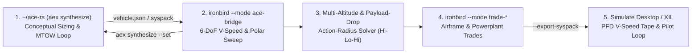

# Mission Profiles, Mid-Mission Payload Drop, Trade Studies & `~/ace-rs` Co-Design

When compiling a **Pilot's Operating Handbook (`POH`)**, **Flight Manual (`NATOPS` / `T.O. 1-1C` / `AFM` Section 5)**, or iterating on a new aircraft configuration in `~/ace-rs`, single-altitude still-air range tables are not sufficient. Real aircraft engineering workflows require:

1. **Multi-Altitude & Mid-Mission Payload-Drop Profiles**: Evaluating `Hi-Hi-Hi`, `Hi-Lo-Drop-Lo-Hi`, `Lo-Lo-Drop-Lo`, and `Hi-Loiter-Hi` profiles where payload stores/cargo are released mid-mission ($\Delta m_{\text{drop}}$) and external store drag is cleaned up ($\Delta C_{D0} \le 0$), solving for the **Maximum Action / Combat Radius $R_{\text{action}}$** (`NM`) and quantifying the post-drop rate-of-climb recovery.
2. **Overall Design (`总体设计`) & Powerplant (`动力装置`) Trade Studies**: Sweeping wing area $S_{\text{ref}}$, aspect ratio $AR = b^2/S$, zero-lift drag $C_{D0}$, structural empty mass, wet-wing fuel volume, engine shaft power (`BHP` / `kW`), and `BSFC` directly through the 6-DoF JSBSim flight dynamics engine.
3. **Closed-Loop Co-Design with Sibling `~/ace-rs`**: Ingesting `~/ace-rs` conceptual `vehicle.json` models, compiling and flying them in 6-DoF JSBSim, exporting ready-to-fly `syspack` directories with synthesized `performance/airspeed_envelope.json`, and feeding 6-DoF trimmed $C_{D0}$, Oswald efficiency $e$, propeller efficiency $\eta_p$, and BSFC back into `aex synthesize --set`.

---

## 1. Standard Flight-Manual Compilation Workflow



| Stage | Engineering Artifact Produced | Tool / API |
|---|---|---|
| **Stage 1 — Conceptual Sizing** | Converged MTOW, OEW, wing loading $W/S$, power-to-weight $P/W$, `vehicle.json` | `~/ace-rs` (`aex synthesize`) |
| **Stage 2 — 6-DoF Envelope Discovery** | $V_{S0}, V_{S1}, V_X, V_Y, V_G, V_A$, climb table, service ceiling, `airspeed_envelope.json` | `sim_pack::estimate_design_performance` |
| **Stage 3 — Mission & Payload-Drop Manual** | `Hi-Hi-Hi`, `Hi-Lo-Drop-Lo-Hi`, `Lo-Lo-Drop-Lo`, `Hi-Loiter-Hi` action radii & segment fuel logs | `sim_pack::evaluate_mission_profile` |
| **Stage 4 — Airframe & Powerplant Trades** | Sensitivity of ceiling, ROC, specific range, and action radius to $\Delta AR, \Delta C_{D0}, \Delta P, \Delta \text{BSFC}$ | `sim_pack::run_design_trade_study` |
| **Stage 5 — Closed-Loop Simulator & Feedback** | Calibrated `syspack` + `--set` parameter corrections back to `~/ace-rs` | `sim_pack::build_ace_feedback_report` |

---

## 2. Multi-Altitude & Mid-Mission Payload-Drop Solver (`mission.rs`)

### Supported Segment Types (`MissionSegmentKind`)

Every `MissionProfileSpec` consists of an ordered sequence of `MissionSegmentSpec` legs:

- `WarmupTakeoff`: Ground taxi, runup, and takeoff allowance (`duration_min`, `throttle_norm`).
- `Climb`: Climb from current altitude to `target_alt_ft` using mass-scaled rate of climb $\mathrm{ROC}(W, h) \propto (W/W_{\text{ref}})^{-1.35}$ and fuel flow.
- `Cruise`: Best-range or normal cruise at `target_alt_ft`; legs marked `is_radius_leg = true` are scaled by the bisection action-radius solver.
- `Dash`: High-speed low-altitude ingress or egress penetration leg (`distance_nm`, `target_alt_ft`).
- `PayloadDrop`: Releases `drop_mass_kg` or `drop_fraction` of initial payload mid-mission and applies `delta_cd0` (negative when external stores/racks are released), reducing aircraft gross weight and drag for all subsequent egress, re-climb, and return legs.
- `Loiter`: Best-endurance patrol on station (`duration_min` near $V_G$).
- `Descent`: En-route or recovery descent to `target_alt_ft`.
- `Reserve`: Fixed IFR/VFR fuel reserve (`45 min` holding fuel).

### Physics of Mid-Mission Payload Release (`Hi-Lo-Drop-Lo-Hi`)

When payload mass $\Delta m_{\text{drop}}$ is released at the target midpoint:

1. **Instantaneous Gross Mass Reduction**:
   $$m_{\text{egress}} = m_{\text{ingress,end}} - \Delta m_{\text{drop}} - m_{\text{fuel,drop\_pattern}}$$
2. **Reduced Induced Drag & Higher Return Cruise Speed**:
   At the same altitude and throttle setting, lift coefficient drops by $C_{L,\text{out}} / C_{L,\text{in}} = m_{\text{in}} / m_{\text{out}}$, reducing induced drag $C_{D,i} = k C_L^2$ and external store parasite drag $\Delta C_{D0}$. In the `Hi-Lo-Drop-Lo-Hi` profile (`138 kg` payload dropped at midpoint), the `296.2 NM` inbound high-altitude cruise leg burns **`49.3 kg` (`18.12 gal`)** at **`121.5 KTAS`**, compared to **`62.8 kg` (`23.06 gal`)** at **`115.1 KTAS`** on the heavy outbound leg.
3. **Faster Post-Drop Egress Re-Climb (6-DoF JSBSim Verification)**:
   `evaluate_mission_profile` runs 6-DoF JSBSim steady climbs before and after payload drop (`measure_post_drop_roc_gain`), verifying a **`+127 fpm` to `+152 fpm`** rate-of-climb gain and cutting the `1,000 ft -> 8,000 ft` re-climb time from `13.6 min` (`7.4 kg` fuel) down to `8.9 min` (`4.8 kg` fuel).
4. **Action-Radius Bonus (`drop_radius_bonus_nm`)**:
   Bisection solving with `allow_drop = true` vs. `allow_drop = false` quantifies the exact action-radius extension (**`+31 NM`** in `Hi-Lo-Drop-Lo-Hi`, **`+41 NM`** in `Lo-Lo-Drop-Lo`).

---

## 3. Overall Design (`总体设计`) & Powerplant (`动力装置`) Trade Studies (`trades.rs`)

Run an automated multi-candidate trade study on the built-in C172 reference or any on-disk `syspack`:

```sh
cargo run --release -p ironbird -- --mode trade-c172
cargo run --release -p ironbird -- --mode trade-dir --package-dir vehicles/c172 --report-out trades.md
```

Each `DesignTradeSpec` perturbs airframe and powerplant parameters directly inside the `LoadedSyspack` (`mbd-core` component masses and JSBSim XML `<metrics>`, `<piston_engine>`, `<propeller>`, and `<axis name="DRAG">`) and re-runs the full 6-DoF JSBSim performance & mission-profile suite:

| Candidate | Empty (kg) | Fuel (gal) | $V_{S0}$ (kt) | $V_Y$ (kt) | SL ROC (fpm) | Ceiling (ft) | $(L/D)_{\max}$ | Norm Crz (KTAS) | Spec. Range (NM/gal) | Ferry (NM) | `Hi-Lo-Drop` Radius (NM) |
|---|---:|---:|---:|---:|---:|---:|---:|---:|---:|---:|---:|
| **Baseline Configuration** | 767.0 | 53.0 | 48.1 | 74.2 | 758 | 15,217 | 9.12 | 106.9 | 15.39 | 963 | **355** |
| **High-AR Clean Wing** (`+8%` Span, `-6%` $C_{D0}$, `+10 kg`) | 777.0 | 53.0 | 48.4 | 78.3 | 803 | 17,544 | **9.87** | 111.0 | **15.81** | 991 | **363** |
| **Uprated Powerplant** (`+14%` Power, `-4%` BSFC, `+8 kg`) | 775.0 | 53.0 | 48.3 | 78.2 | **1,052** | **18,818** | 9.13 | **117.2** | 13.97 | 870 | 315 |
| **Extended Wet-Wing Fuel** (`+22%` Fuel, `+4%` Area, `+6 kg`) | 773.0 | 64.7 | 48.0 | 77.7 | 703 | 14,682 | 9.02 | 105.6 | 15.25 | **1,182** | **438** |

---

## 4. Seamless Closed-Loop Iteration with Sibling `~/ace-rs` (`ace_bridge.rs`)

`ironbird --mode ace-bridge` connects `~/ace-rs` (`aex`) and `Simulate` into a single closed-loop design pipeline:

```sh
cargo run --release -p ironbird -- \
  --mode ace-bridge \
  --ace-vehicle ~/ace-rs/examples/c172/vehicle.json \
  --export-syspack /tmp/ace_c172_calibrated \
  --report-out ace_c172_feedback.md
```

### What `--mode ace-bridge` Executes

1. **Direct `vehicle.json` Ingestion (`load_syspack_from_ace_vehicle_json`)**:
   Reads `wing.area`, `wing.span`, `aero.cd0`, `weight.oew`, `weight.maximum_fuel`, `engine.rated_power`, `engine.sizing_factor`, and `engine.bsfc` from the `~/ace-rs` JSON document and synthesizes a SHA-256-verified `LoadedSyspack`.
2. **6-DoF JSBSim Flight-Manual & Mission Evaluation**:
   Sweeps stall, climb, glide, cruise polar, payload–range, and all four multi-altitude / payload-drop mission profiles (`Hi-Hi-Hi`, `Hi-Lo-Drop-Lo-Hi`, `Lo-Lo-Drop-Lo`, `Hi-Loiter-Hi`).
3. **Complete `syspack` Export (`--export-syspack <DIR>`)**:
   Writes `syspack.json`, `fdm/*.xml`, and the newly synthesized `performance/airspeed_envelope.json` with updated SHA-256 digests so the aircraft can immediately be flown in `simulate-app` or `ironbird --mode tier0-dir`.
4. **Closed-Loop Parameter Feedback to `~/ace-rs` (`AceFeedbackReport`)**:
   Extracts the 6-DoF trimmed cruise $C_{D0}$ (accounting for elevator trim drag and alpha polar tables), effective Oswald efficiency $e$, cruise & climb propeller efficiencies $\eta_p$, and altitude-lapsed BSFC, and outputs a ready-to-run `aex synthesize` command:

```sh
cargo run --manifest-path ~/ace-rs/Cargo.toml --bin aex -- synthesize examples/c172/vehicle.json \
  --set 'aero.cd0=0.0396' \
  --set 'aero.oswald=0.780' \
  --set 'propeller.efficiency=0.788' \
  --set 'engine.bsfc=0.221 kg/kWh' \
  --format json
```
